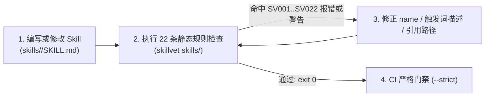

# skillvet

[English](README.md) | [简体中文](README.zh-CN.md)

**Agent Skills 静态检查器：专门捕捉那些“能被加载、但永远不会被触发”的隐蔽错误。**


[](https://github.com/NPLMSHJTR/skillvet/actions/workflows/ci.yml)

智能体每轮对话只会读取 `SKILL.md` 的 `name` 和 `description` 来决定是否激活技能，这 200 个字符是整个技能系统的核心决策面，也是绝大多数 Skill 悄然失效的地方。`skillvet` 基于 [Agent Skills 规范](https://agentskills.io/specification) 提供 22 条静态规则、零强制依赖，并支持直接在 CI 中做门禁。

```console
$ skillvet skills/

W skills/pdf-tables/SKILL.md (pdf-tables) — 2 warnings
    warn SV009 `description` never says when the skill should be used
         Add an explicit trigger, for example "Use when the user asks to ...".
    warn SV011 `description` is only 24 characters
         Short descriptions tend to under-trigger.

P skills/changelog/SKILL.md
    no findings

2 skills checked · 1 with warnings · 1 clean
```

## 操作工作流与流程图



## 安装与常用工作流命令

```bash
pipx install skillvet
# 或无需安装包直接运行（零强制依赖，PyYAML 可选）：
git clone https://github.com/NPLMSHJTR/skillvet && cd skillvet && python -m skillvet path/to/skills
```

```bash
skillvet                      # 递归检查当前目录
skillvet skills/              # 检查指定技能目录树
skillvet skills/pdf/SKILL.md  # 检查单个 SKILL.md
skillvet --strict skills/     # 将警告也视为失败（CI 门禁）
skillvet --format json        # 输出 JSON 供编辑器或面板消费
skillvet --no-info skills/    # 隐藏 info 级风格建议
```

退出码：`0` 全部通过；`1` 命中等于或高于阈值的规则；`2` 用法错误或未找到 `SKILL.md`。

## 22 条检查规则覆盖范围

- **Frontmatter 规范（`SV001`–`SV015`）**：校验 `name` 长度（≤64）、字符集（`a-z0-9-`）、与父目录同名（`SV006`，曾在 `openai/codex` 官方内部技能中抓出真实不匹配）、`description` 非空单行且 ≤1024 字符、触发时机短语检查（`SV009`，支持英文与中文触发词）、长度与格式校验。
- **正文与引用（`SV016`–`SV022`）**：正文非空且建议 <500 行、相对路径引用（`SV019`）、一层目录深度（`SV020`）、引用文件真实存在（`SV021`）、`scripts/` 下脚本均在文档提及（`SV022`）。

详细规则、反模式案例与实测笔记见 [docs/rules.md](docs/rules.md)、[docs/anti-patterns.md](docs/anti-patterns.md) 与 [docs/field-notes.md](docs/field-notes.md)。

## 开源协议

MIT，详见 [LICENSE](LICENSE)。
